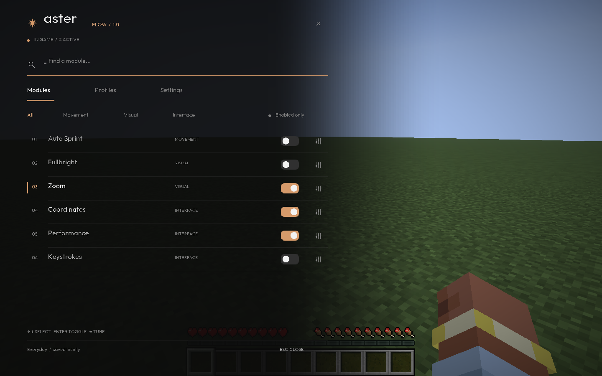

# Aster 1.0

A modern, client-only Fabric mod for **Minecraft 26.3**, using **Fabric Loader 0.19.5+**, matching **Fabric API 0.162.0+26.3**, and **Java 25**.

**Aster Flow** is a frameless command rail over the current world or menu scenery. Dark charcoal fades across the scene; muted orange (#D59A6A), Outfit typography, fine rules, and numbered rows give the interface its own visual language. Module settings unfold directly beneath their row. Search, categories, profiles, and keyboard navigation share the same layout, which adapts to window size and GUI scale.



[Menu view](docs/screenshots/flow-menu.png) · [Inline settings](docs/screenshots/flow-inline.png) · [Compact window](docs/screenshots/flow-compact.png)

## Install

Download [aster-client-1.0.0.jar](https://github.com/StemZ-DEV/aster-client/releases/latest) and put it beside the matching Fabric API JAR in your Minecraft 26.3 Fabric profile's `mods` folder. Launch that profile and use **Open Aster** on the title screen, or **Right Shift** in gameplay and menus.

[Installation and troubleshooting](docs/INSTALL.md) · [Release notes](docs/RELEASE_NOTES.md) · [Changelog](CHANGELOG.md)

The installable JAR is also included in the release ZIP with documentation and screenshots. Source archives are for developers. SHA-256 checksums accompany all release assets.

## Develop

Install JDK 25, then from this folder:

```sh
./gradlew runClient
```

On macOS, if your shell uses an older JDK:

```sh
JAVA_HOME=$(/usr/libexec/java_home -v 25) ./gradlew runClient
```

Development launches open Flow automatically after the title screen loads. In an installed build, use **Open Aster** on the title screen or **Right Shift** in game and menus. The shortcut respects text input capture. Escape returns to the exact screen you came from. Opening from gameplay keeps the world running; opening from the pause menu keeps singleplayer paused. The crosshair hides while Flow is open.

## Controls

| Action | Control |
| --- | --- |
| Open / close Flow | Right Shift |
| Focus module search | Ctrl+K / Command+K |
| Select a module | Up / Down, including while searching |
| Toggle selected search result | Enter |
| Expand inline settings | Sliders icon, or Right with an empty search |
| Collapse inline settings | Click the same sliders icon, or Left outside search |
| Browse additional rows | Mouse wheel, or Up / Down |
| Navigate controls | Tab / Shift+Tab |
| Activate focused control | Enter / Space |
| Adjust a focused slider | Left / Right |
| Smooth zoom | Hold C |
| Assign a module toggle key | Expand its row, then click Bind a key |
| Clear a module toggle key | Backspace / Delete while binding |
| Cancel binding | Escape |

Typing starts a search immediately after opening. Escape clears a search first, then closes Flow. Click a module row or its switch to toggle it; the sliders icon expands its controls. Rebind the Flow and hold-to-zoom keys in Minecraft's Controls menu. Module shortcuts are stored per profile. A shortcut cannot use the current Flow or zoom key; assigning a used shortcut moves it to the selected module.

## Working modules

- **Auto Sprint:** automatically sprints while moving forward, with a configurable food threshold.
- **Fullbright:** adjusts the rendered lightmap with configurable intensity. It does not edit Minecraft's saved gamma setting or add player effects.
- **Zoom:** smoothly changes camera FOV while its key is held; configurable 2–10× magnification.
- **Coordinates:** position readout with adjustable scale.
- **Performance:** live FPS display with adjustable scale.
- **Keystrokes:** WASD, mouse, and jump input feedback with adjustable scale.

The default Everyday profile enables Zoom, Coordinates, and Performance. Minimal and Movement profiles provide alternate setups. Save a new profile to snapshot your current settings. Edit its name and press Enter or Rename; Delete asks for a second click and Escape cancels. Profiles have independent module states, settings, and shortcuts. Up to 32 profiles are supported, with names up to 24 characters; at least one must remain.

All changes save automatically to `config/aster/client.json`. A malformed config is backed up before using defaults, preserving earlier backups. A newer config format is protected from overwriting. The footer reports saving or recovery problems. Resetting a profile also asks for confirmation.

## Build and test

```sh
./gradlew build
./gradlew test
./gradlew runClientGameTest
./gradlew prepareRelease
```

Install the non-sources JAR from `build/libs/` into your Minecraft 26.3 Fabric profile's `mods/` folder, alongside the matching Fabric API. This is a mod, so it uses your existing Minecraft installation and account.

Unit tests cover persistence, named profile creation/rename/deletion, profile limits, imported bindings, write failures, corruption recovery, preservation of newer formats, value limits, and filtering. Native client tests verify input, inline settings, profiles, scrolling, menu restoration, pause behavior, camera zoom, lightmap Fullbright, module shortcuts, and Auto Sprint. They capture the interface at 1440×900 and 960×540. Client tests need a graphical session. Their disposable settings and world are stored in `build/run/clientGameTest/`, separate from development play settings.

`prepareRelease` writes the production JAR, source JAR, release/source ZIPs, and `SHA256SUMS.txt` to `build/release/1.0.0/`. Archives use stable entry ordering and timestamps. CI builds and tests on Windows, macOS, and Linux; Linux also runs the native tests under Xvfb. A version tag creates a draft GitHub Release after checks pass.

English is the supported UI language. Minecraft versions other than 26.3 and third-party mod combinations have not been validated. Use modules according to your server's rules.

## Extend

- `src/main/java/dev/aster/core/`: module metadata, filtering, profiles, validated configuration.
- `src/client/java/dev/aster/client/`: Fabric lifecycle, inputs, and module runtime behavior.
- `src/client/java/dev/aster/client/ui/`: native command rail, widgets, and HUD.
- `src/client/java/dev/aster/client/mixin/`: scoped camera and lightmap hooks.
- `src/main/resources/assets/aster/`: font, translations, and generated UI primitives.

Add module metadata in `ModuleRegistry`, then implement its behavior using client events or a scoped mixin. The interface discovers registry modules automatically and scrolls when rows exceed the available space.

Recreate icons and rounded switch/HUD primitives with `java tools/GenerateAssets.java`. Outfit is bundled under the SIL Open Font License; its license is in `assets/aster/font/ofl.txt`.

Fabric references: [project structure](https://docs.fabricmc.net/develop/getting-started/project-structure), [custom screens](https://docs.fabricmc.net/develop/rendering/gui/custom-screens), [key mappings](https://docs.fabricmc.net/develop/key-mappings), [official 26.3 template](https://github.com/FabricMC/fabric-example-mod/tree/26.3).
